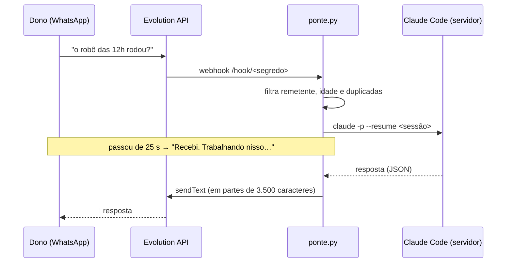

# Ponte WhatsApp → Claude Code · um agente de IA no servidor, comandado pelo celular

`EM USO DIÁRIO` · Código-fonte privado. Aqui ficam a apresentação e a arquitetura.

> *EN: A ~200-line Python bridge that lets the server owner talk to a Claude Code agent running on a VPS through WhatsApp (Evolution API webhooks), with session resume, queueing and strict sender filtering.*

---

## O problema

Servidor com dezenas de robôs rodando, e o dono longe do computador: na rua, na faculdade, sem notebook. Para conferir um log, corrigir um robô parado ou fazer um ajuste rápido, eu precisava estar na frente do terminal.

## A solução

Escrevo no WhatsApp, na conversa comigo mesmo, e um **agente Claude Code dentro do servidor** executa o pedido e responde ali. Ele lê logs, edita arquivos, roda comandos e explica o que fez.

## Segurança (a parte que mais importa)

Um agente com acesso ao terminal comandado por mensagem é perigoso se for mal feito. As travas:

- **Só o dono:** aceita apenas mensagens `fromMe` na conversa do dono consigo mesmo. Qualquer outro número é ignorado
- **URL secreta:** o webhook só responde em `/hook/<segredo>` (comparação em tempo constante). O resto dá 404
- **Escuta só local:** `127.0.0.1`, atrás do proxy reverso
- **Sem eco:** toda resposta começa com 🤖, e a ponte ignora as próprias mensagens para não entrar em laço
- **Sem mensagem velha:** descarta eventos com mais de 3 minutos (reentregas do webhook)
- **Confirmação humana:** as regras do agente exigem pedir "ok" antes de apagar, publicar ou reiniciar algo
- **Uma tarefa por vez:** fila com um único worker e limite de 40 minutos por pedido

## Recursos

- Continua a mesma conversa por até 6 h (`--resume`). `/novo` zera o contexto
- Se a sessão antiga falhar, tenta de novo numa conversa nova
- Mostra "digitando…" e divide respostas longas

## Código

O código-fonte é privado. Posso mostrar o funcionamento numa conversa ou entrevista.

## Stack

---

Projeto de [Leonardo Magalhães](https://github.com/leomagalhaesti) · Licença: veja [LICENSE](LICENSE).
